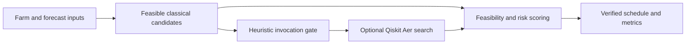

<div align="center">

# JalQ-R | Quantum_coderz

**VTU-QFF-HC-0167** &nbsp;|&nbsp; Tier: **Online**

</div>

---

<div align="center">

| | |
| :--- | :--- |
| **Team** | Quantum_coderz |
| **Team ID** | VTU-QFF-HC-0167 |
| **Tier** | Online |
| **Repository** | [vtu-hc-quantum-coderz](https://github.com/vtu-qiskit-fall-fest-2026/vtu-hc-quantum-coderz.git) |
| **Organisation** | [vtu-qiskit-fall-fest-2026](https://github.com/vtu-qiskit-fall-fest-2026) |
| **Event** | VTU-QFF Hackathon — VTU-Qiskit Fall Fest 2026 |

</div>

---

> **Initial demo skeleton — research implementation in progress.** Numerical classical planning and an optional Qiskit Aer candidate generator. No quantum advantage or validated efficiency improvement is claimed. See [TODO.md](TODO.md) for known gaps and [demo notes](docs/demo-notes.md) for the supplied skeleton's original documentation.

## 📌 Table of Contents

- [Team Members](#-team-members-github-ids)
- [Problem Statement](#-problem-statement)
- [Proposed Solution](#-proposed-solution)
- [Approach & Architecture](#-approach--architecture)
- [Tech Stack](#-tech-stack)
- [Project Structure](#-project-structure)
- [How to Run](#-how-to-run)
- [How to Push Code](#-how-to-push-code)
- [Submission Checklist](#-submission-checklist)
- [Resources](#-resources)
- [License](#-license)

---

## 👥 Team Members (GitHub IDs)

> Members are added to this repository as **collaborators** and must accept the
> GitHub invitation before they can push. Add your GitHub username below.

| # | Name | GitHub Username | Role |
| :-- | :--- | :--- | :--- |
| 1 | Shylan Kamesh S | shylankamesh | _Team Lead_ |
| 2 | Sai Santhosh T | tsaisanth29-ece | _Developer_ |
| 3 | Derin Godson | Derin-Godson | _Developer_ |

<!--
Optional: add a plain list instead of the table above.
- @username1
- @username2
-->

---

## ❓ Problem Statement

**Problem:** Allocate a fixed quota of irrigation events across eligible field-time slots under uncertain weather. Investigate whether selective quantum replanning can maintain schedule quality while reducing quantum execution cost.

**Why it matters:** Forecast changes can make an existing plan less suitable; additional optimization must justify its computational cost. The synthetic model optimizes timing at exactly K equal-size events and does not demonstrate water savings.

**Track / Category:** Online · Quantum Applications for Climate Change & Sustainability

---

## 💡 Proposed Solution

**Solution:** JalQ-R generates feasible classical schedules, evaluates expected moisture stress and empirical tail risk, and uses a heuristic forecast-response gate to request optional quantum candidate search. It retains the best verified classical or quantum candidate.

**Key idea:** Selective invocation of fixed-weight XY-QAOA with explicit classical fallback.

**Current status:** The planner enforces explicit rolling call and shot budgets, detects changes to rainfall and evaporation forecasts, and always retains a classically verified schedule. The optional quantum branch uses three fixed parameter trials at p=1 and ideal Aer simulation. Stronger quantum baselines, noise experiments, and additional held-out evaluation remain future work. Quantum execution must be verified in an environment with Qiskit and Aer installed.

---

## 🧩 Approach & Architecture



1. **Input:** Three fields, four windows, synthetic forecasts, eligibility, moisture and remaining quota.
2. **Classical core:** Greedy and bounded swap-based local search with risk-aware scoring.
3. **Quantum core:** Expected-stress QUBO mapped to RZ/RZZ gates and XXPlusYY mixing. Full CVaR is not encoded in the phase circuit.
4. **Verification:** Check exact quota and rescore candidates classically. Missing Qiskit is reported as unavailable.
5. **Evaluation:** An explicit offline endpoint computes the exact optimum; online planning does not consult it. The dashboard comparison is exploratory, not a validated benchmark.

---

## 🛠️ Tech Stack

| Layer | Technology |
| :--- | :--- |
| Language | Python 3.11+ |
| API | FastAPI, Uvicorn, Pydantic |
| Numerics | NumPy |
| Quantum | Qiskit, Qiskit Aer (optional for classical demo) |
| Frontend | HTML, CSS, vanilla JavaScript |
| Tests | pytest, FastAPI TestClient (HTTPX / HTTPX2) |
| Version control | Git + GitHub |

---

## 📁 Project Structure

```text
vtu-hc-quantum-coderz/
├── README.md
├── TODO.md
├── requirements.txt
├── requirements-classical.txt
├── requirements-dev.txt
├── planner.py
├── quantum_engine.py
├── server.py
├── start_windows.bat
├── start_mac_linux.sh
├── static/                 # HTML, CSS, JavaScript
├── tests/test_planner.py
└── docs/demo-notes.md       # Original supplied skeleton notes
```

---

## 🚀 How to Run

Clone this assigned repository, then create a virtual environment. A classical-only install is sufficient to run the dashboard:

```powershell
git clone --branch test --single-branch https://github.com/vtu-qiskit-fall-fest-2026/vtu-hc-quantum-coderz.git
cd vtu-hc-quantum-coderz
python -m venv .venv
.\.venv\Scripts\Activate.ps1
python -m pip install -r requirements-classical.txt
python -m uvicorn server:app --reload
```

Open http://127.0.0.1:8000. On macOS/Linux use `python3 -m venv .venv` and `source .venv/bin/activate`.

To enable genuine local Aer simulation, install `requirements.txt` in the same environment. Requested quantum runs report unavailable when Qiskit/Aer are absent. The browser stores demo state and remaining budget locally; choose **Reset demo** to restore the sample scenario and initial budget.

### Tests

```powershell
python -m pip install -r requirements-dev.txt
python -m pytest -q
```

Development requirements include the classical web dependencies and test tools; install `requirements.txt` as well to exercise Qiskit. The canonical test suite is under `tests/`.

### Validation of this initial upload

- Python syntax: four source/test files passed parsing.
- Frontend JavaScript: `node --check static/app.js` passed.
- Targeted numerical checks: default eight-variable QUBO/Ising mapping matched all 256 bitstrings within 1e-7; quota and one rolling-horizon preservation check passed.
- Full pytest/API and Qiskit execution were not run in the upload environment because dependencies were unavailable.

No performance benchmark or quantum advantage is established.

---

## 🔁 How to Push Code

> Full walkthrough: **[Git & Collaboration Handbook](../vtu-hc-guide-git-and-collaboration)** — collaboration
> workflow, branches, pull requests, reviews and conflict resolution.

### Configure Git (first time only)

```bash
git config --global user.name  "Your Name"
git config --global user.email "you@example.com"
```

### Everyday workflow

```bash
# Stay on the assigned test branch
git checkout test
git pull --ff-only origin test

# Commit work on test
git add .
git commit -m "fix: enforce rolling quantum budgets"

# Push only to test
git push origin test
```

Do not commit, push, or merge assignment changes to `main`.

### Commit message convention

| Prefix | Meaning |
| :--- | :--- |
| `feat:` | New feature |
| `fix:` | Bug fix |
| `docs:` | Documentation only |
| `test:` | Adding or fixing tests |
| `refactor:` | Code restructure, no behaviour change |
| `chore:` | Build/config/dependency changes |

### Useful commands

```bash
git status              # what changed
git log --oneline -10   # recent commits
git diff                # review changes before committing
git stash               # shelve changes temporarily
git pull --ff-only origin test  # update only the assigned branch
```

### Collaborating on the same repo

- **Keep assignment changes on `test`** and review the branch diff before pushing.
- **Pull before you push** to avoid rejected commits.
- **Commit often** with clear messages.
- **Resolve conflicts** locally: `git pull --rebase`, fix the files, then `git add` + `git rebase --continue`.
- **Ask for a review** before merging — a second pair of eyes catches bugs fast.

---

## ✅ Submission Checklist

- [ ] Assigned event repository used; visibility follows organizer instructions
- [ ] All team members added as **collaborators** and invitations accepted
- [ ] `README.md` updated with project details, problem statement and solution
- [ ] Team members listed under [Team Members](#-team-members-github-ids)
- [ ] `requirements.txt` committed and project runs from a clean clone
- [ ] Code pushed to the assigned `test` branch and verified there
- [ ] Notebooks committed with **cleared outputs** (or use `nbstrip`)
- [ ] `README` includes a demo screenshot / video link
- [ ] Short project summary submitted on the hackathon portal

---

## 📚 Resources

| Resource | Link |
| :--- | :--- |
| 🔁 Git & collaboration handbook | [Git & Collaboration Handbook](../vtu-hc-guide-git-and-collaboration) |
| ❓ Problem statements, solutions & terms | [Problem Statements, Solutions & Terms](../vtu-hc-guide-problem-and-solution) |
| 📄 README writing guide | [README Guide & Template](../vtu-hc-guide-readme-template) |
| ⚛️ Qiskit documentation | https://docs.quantum.ibm.com/ |
| ⚛️ Qiskit Runtime & primitives | https://quantum.cloud.ibm.com/docs/ |
| 🧪 Qiskit Aer simulator | https://docs.quantum.ibm.com/guides/simulator |
| 💻 IBM Quantum Platform | https://quantum.cloud.ibm.com/ |
| 🎓 Qiskit textbook | https://qiskit.qotlabs.org/learning/ |
| 📋 GitHub Docs | https://docs.github.com/ |

---

### Research references and attribution

- [Irrigation QAOA formulation](https://arxiv.org/abs/2607.13374)
- [Warm-start QAOA with XY mixers](https://arxiv.org/abs/2504.19934)
- [Iterative warm-start XY mixers](https://arxiv.org/abs/2604.02083)
- [Initial-state/mixer alignment](https://www.nature.com/articles/s41534-023-00787-5)

This commit imports the supplied demo skeleton. Code preparation and documentation used AI assistance; the team must understand, test, and attribute its submission according to event rules. Research components are prior art; originality and efficiency are not certified.

## 📄 License

Released under the [MIT License](LICENSE). See `LICENSE` for details.

---

<div align="center">

**Quantum_coderz** · Team ID `VTU-QFF-HC-0167` · Tier `Online`
· Built with ⚛️ Qiskit for the VTU-QFF Hackathon

[⬆ Back to Top](#quantum_coderz)

</div>

